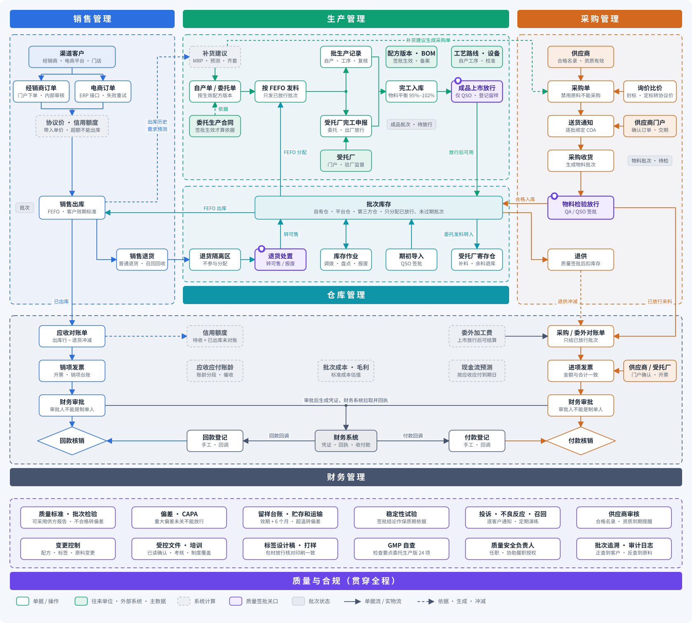
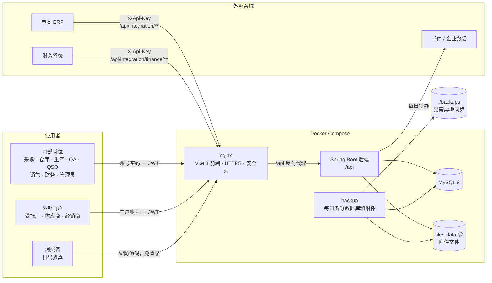
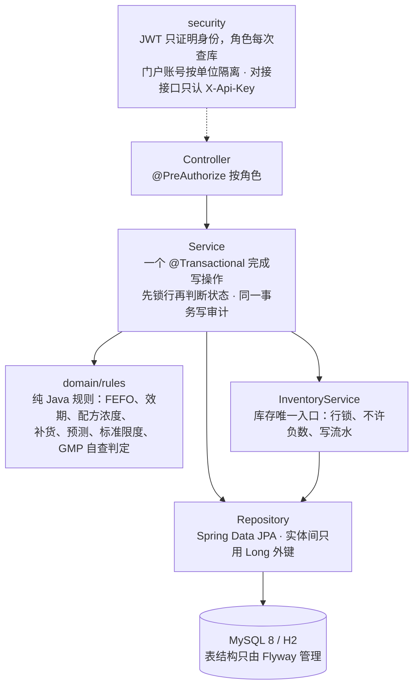
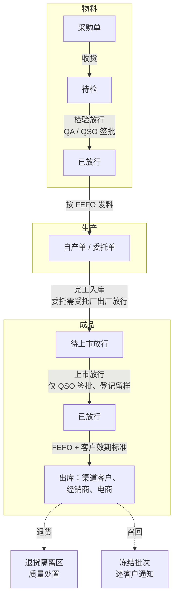

# 化妆品批次主线系统（一期）

化妆品品牌方（注册人 / 备案人）的供应链和质量管理系统，按《化妆品生产质量管理规范》（下称 GMP）和《化妆品生产质量管理规范检查要点（委托生产版）》设计，面向“委托代工 + 自有工厂”混合生产、多渠道销售的成长期品牌。主线是：

**主数据 → 采购收货 → 物料检验放行 → 生产 / 委托生产 → 成品上市放行 → FEFO 销售出库 → 批次正反向追溯**，全程审计留痕。

给使用者看的说明见 [岗位操作手册](docs/操作手册.md)；开发规则见 [CLAUDE.md](CLAUDE.md)。

目录：[主要功能](#主要功能) · [系统架构](#系统架构) · [模块](#模块) · [一、本地运行](#一本地运行开发) · [二、部署](#二部署到服务器docker) · [三、合规落地点](#三合规要求在代码里的落地点) · [四、工程结构](#四工程结构) · [五、测试](#五测试) · [六、后续计划](#六一期没有做后续计划)

## 主要功能

| 领域 | 功能 |
| --- | --- |
| 批次主线 | 主数据（物料、往来单位、仓库、BOM，CSV 批量导入）；采购收货；物料检验放行；自产和委托生产（发料、补料、余料退库、完工、物料平衡）；成品上市放行（只有质量安全负责人能放行）；按先到期先出和客户效期标准出库；批次正反向追溯，可打印存档 |
| 库存 | 调拨、盘点、报废；期初库存导入；退货隔离区；受托厂寄存仓料账；批次标签打印和扫码核对 |
| 质量体系 | 质量标准和批次检验（可采用供方报告）；偏差与 CAPA；供应商审核；留样台账；设备校准；投诉、不良反应上报时限和召回；召回演练（模拟召回，按出库列出要联系的对象，算用时和定位率，没达标转 CAPA）；销售退货质量处置；GMP 自查（检查要点委托生产版 24 项）；质量安全负责人任职和协助履职授权；委托生产合同（质量协议）签批，委托单的合同依据；受托生产监督（驻厂、现场检查、调阅记录，问题转 CAPA，QSO 审核）；仓库和留样室的温湿度范围和记录（导入记录仪数据，超限转偏差）；留样地点和向药监部门的报告（按首次留样算 20 个工作日截止日） |
| 研发和合规 | 配方版本和备案（签批生效、版本对比、原料反查）；原料法规目录（只能导入，不内置）；产品合规资料；稳定性试验；新品立项和上市检查；受控文件（已读确认、培训考核、纸质副本、制度覆盖）；变更控制；标签设计稿和印刷打样签样；PIF 产品信息档案 |
| 自产执行 | 工艺路线；电子批生产记录（清场、按序执行工序、关键工序复核、过程检验超限自动生成偏差） |
| 供应链协同 | 代工厂门户（进度、完工和出厂放行申报、委外对账）；供应商门户（确认订单、交期、送货通知带 COA）；经销商订货门户；询价比价（封标、多轮议价）；退货给供应商；补货建议（需求预测、BOM 展开、齐套预检）；一物一码和消费者扫码验真 |
| 结算和对接 | 采购和委外对账（三单匹配、多税率、红字冲减、发票退回）；供应商和客户协议价；客户应收和回款核销；客户信用额度；应付应收账龄；电商 ERP 订单接口；财务系统凭证和收付款回调接口 |
| 分析和提醒 | 总览待办和每日提醒（邮件、企业微信，按岗位分发）；经营看板（库存金额、效期、呆滞、准时率、收率、放行周期）；供应商绩效；批次成本、毛利、现金流、盘点报废损益、库存 ABC；PQR 年度质量回顾；各模块闭环监控看板；全量 Excel 导出 |
| 平台和安全 | 账号和角色、门户按单位隔离数据；关键签批再次输入密码；审计日志只增不改；登录锁定和密码策略；附件防篡改（SHA-256）；上线检查和签字确认表；HTTPS、自动备份、健康检查；计算机化系统验证文档包 |

界面采用 Liquid Glass 风格（半透明毛玻璃，跟随系统深浅色），手机宽度可用。

## 系统架构

业务流程架构：按销售、生产、采购、仓库、财务分区，紫色是质量签批关口，彩色箭头是单据和实物的流向，虚线是依据、生成和冲减关系。点开图片可看原尺寸。

<picture>
  <source media="(prefers-color-scheme: dark)" srcset="docs/diagrams/business-flow-dark.svg">
  
</picture>

图由 `scripts/business-flow-svg.py` 生成（浅色、深色各一份），改了主线流程或模块名称后改脚本重新生成。

部署和对接：



后端分层和几条贯穿全局的约束：



批次在主线上的状态：



`batch_genealogy`（成品用了哪些物料批次）、`mfg_issue`（发料）、`so_allocation`（出库批次）三张表把批次串起来，`TraceService` 从任一批号正查到客户、反查到原料和受托厂代采批号。

| 层 | 技术 |
| --- | --- |
| 后端 | Java 17+（已验证 17 与 27）、Spring Boot 3.5、Spring Data JPA、Spring Security（JWT）、Flyway |
| 数据库 | MySQL 8（生产）；本地开发用 H2 文件库，免安装 |
| 前端 | Vue 3、Vite 8、Element Plus、Pinia、Vue Router；JavaScript，图表是纯 HTML / CSS |
| 部署 | Docker Compose（MySQL + 后端 + nginx + 备份） |

## 模块

后端按业务分包（`backend/src/main/java/com/cosmetic/scm/`），包之间只通过 Repository 读写，不互相注入服务。

| 领域 | 后端包 | 主要页面 |
| --- | --- | --- |
| 主数据 | `master` | 主数据（物料、往来单位、仓库、BOM） |
| 采购 | `purchase`、`sourcing`、`supplierreturn` | 采购入库（含供应商协议价、催货看板）、询价比价、退供 |
| 库存 | `inventory` | 库存、库存作业（调拨、盘点、报废、期初导入）、扫码作业、批次标签 |
| 生产 | `production`、`mes` | 生产与委托（寄售料账、物料超耗）、配方与备案 → 工艺路线、批生产记录 |
| 质量放行 | `quality` | 质量放行（检验录入、不合格品处置）、质量标准 |
| 销售 | `sales`、`salesreturn`、`dealer` | 销售出库（含客户协议价）、产品销售记录、销售退货、经销商订单 |
| 投诉召回 | `complaint`、`recall` | 投诉与召回 |
| 质量体系 | `qms`、`oemcontract` | 质量体系（偏差、CAPA、供应商审核、留样、设备校准）、GMP 自查、质量安全负责人、委托合同 |
| 研发合规 | `plm` | 配方与备案、合规资料（法规目录）、稳定性试验、新品立项、受控文件、变更控制、标签设计稿 |
| 外部门户 | `oemportal`、`supplierportal`、`dealer` | 代工厂门户、供应商门户、经销商门户 |
| 结算 | `settlement` | 对账结算（应付、委外、客户应收、账龄、进项台账） |
| 对接 | `integration` | 电商对接（订单、异常重试、对接日志、接入说明） |
| 计划 | `planning` | 补货建议（MRP、需求预测、齐套预检） |
| 一物一码 | `serial` | 一物一码、消费者验真页 `/v/码` |
| 追溯 | `trace` | 批次追溯 |
| 分析和提醒 | `dashboard`、`analytics`、`report`、`notify` | 总览、经营看板、各页导出、消息提醒 |
| 平台 | `security`、`audit`、`attachment`、`golive`、`common`、`demo` | 账号与权限、审计日志、各页附件、上线检查 |
| 纯规则 | `domain/rules` | — |

单独的打印页（不套主布局）：批生产记录、稳定性试验报告、GMP 自查报告、对账单、PIF、PQR、上线检查签字确认表、批次标签；追溯报告在追溯页直接打印。

---

## 一、本地运行（开发）

需要：JDK 17 或以上、Maven 3.9、Node.js 20.19 或以上。

```bash
# 1. 启动后端（默认 dev 配置：H2 文件库 + 自动写入示例数据）
cd backend
mvn spring-boot:run
# 看到 “已写入示例数据” 的日志即启动完成，接口在 http://localhost:8080/api

# 2. 另开一个终端启动前端
cd frontend
npm install
npm run dev
# 浏览器打开 http://localhost:5173
```

国内网络如果 Maven 或 npm 下载慢，可以分别配置阿里云 Maven 镜像和 `npm config set registry https://registry.npmmirror.com`。

### 账号

| 账号 | 密码 | 角色 | 用来体验 |
| --- | --- | --- | --- |
| admin | Admin@123456 | 系统管理员、主数据管理 | 主数据、账号与权限 |
| purchase1 | Demo@12345 | 采购、仓库 | 下采购单、收货 |
| prod1 | Demo@12345 | 生产计划、仓库 | 生产单、发料、完工入库 |
| qa1 | Demo@12345 | 质量检验 | 物料检验放行、冻结批次 |
| qso1 | Demo@12345 | 质量安全负责人、质量检验 | **成品上市放行**、解冻 |
| sales1 | Demo@12345 | 销售 | 销售出库、客户协议价 |
| viewer1 | Demo@12345 | 只读 | 只能查看 |
| oem1 | Demo@12345 | 代工厂门户（禾川生物） | 回传进度、申报完工与出厂放行、确认委外对账和开票 |
| finance1 | Demo@12345 | 财务 | 审批对账单、登记付款，客户应收和回款 |
| sup1 | Demo@12345 | 供应商门户（华澄化工） | 确认订单、回复交期、发送货通知、上传 COA 和资质文件 |
| dealer1 | Demo@12345 | 经销商门户（华东经销商） | 按可订数量下单、查发货批号、确认召回通知、查应收对账单 |

示例账号只在 dev 配置下创建。admin 的初始密码由 `SCM_ADMIN_PASSWORD` 决定，**首次登录后请立即修改**。

### 示例数据里能直接走的流程

启动后总览页会出现这些待办，可以按顺序体验完整主线：

1. **物料待检**：用 `qa1` 在“质量放行”给新到的烟酰胺签批放行（需要再次输入密码）。
2. **待发料**：用 `prod1` 在“生产与委托”打开自产面霜工单，点“发料”。预览里会看到苯氧乙醇先用了临近效期的旧批次（先到期先出）。然后点“完工入库”。
3. **待上市放行**：用 `qso1` 审核签批两个成品批次。`qa1` 没有这个权限，只能录检验结果。
4. **销售出库**：用 `sales1` 给京东自营入仓发烟酰胺精华液。该客户要求剩余效期 ≥ 67%，预览里会提示一批 14 个月前生产的老批次（剩余约 61%）被排除；换成天猫旗舰店（≥ 50%），这批老货会按先到期先出被优先分配。
5. **追溯**：在“批次追溯”输入任一批号，向上能查到原料批次和受托厂的代采原料批号，向下能查到发往的客户、退回和召回记录。用 `qa1` 可以一键冻结受影响批次。
6. **投诉与召回**：示例里有一条天猫消费者的不良反应投诉（待上报）。用 `qso1` 在“投诉与召回”对它点“召回”：弹窗先列出将通知的客户和数量，签批后批次被冻结。在召回详情里逐个“标记已通知”；没通知完不能关闭。用 `sales1` 点“登记回收”会跳到销售退货并带上客户和召回单。“召回演练”页签里有第一批精华液的一次模拟召回（已审核）；用 `qa1` 对任一已发货的成品批次发起演练，逐个登记联系结果，有联系不上的算没达标，要转 CAPA 才能提交，批次不会被冻结。
7. **销售退货**：示例里天猫退回 20 瓶外箱破损的精华液，在退货隔离区等待处置。用 `qa1` 点“处置”，签批“转可售”（移回华东主仓）或“报废”。隔离区的货不会被出库分配到。
8. **库存作业**：用 `prod1`（含仓库角色）做仓间调拨或盘点（盘点表直接填实盘数，差异自动算）；报废要 `qa1` 签批。
9. **主数据导入**：用 `admin` 在“主数据 → 物料 / 往来单位 / BOM”点“批量导入”（BOM 导入的是首版配方），下载模板，用 Excel 填好后另存为 CSV 上传，预检通过再确认。任何一行有错都不会写入。
10. **代工厂门户**：用 `oem1` 登录只能看到委托给禾川的单子。对“已发料”的委托单点“申报完工与出厂放行”，填成品批号、出厂检验报告、放行人和代采原料批号。再用 `prod1` 在“生产与委托”里点“完工入库”，弹窗已按申报预填；也可以在明细里退回申报。
11. **委外加工费和寄存仓**：发给受托厂的品牌供料会同时记进它的寄存仓（示例里是“禾川寄存仓”），在“生产与委托 → 委外寄售料账”看在厂余量。已发料的单子可以“补料”和“余料退库”，都要写原因；“物料超耗与平衡”按净发料对比标准用量。`purchase1` 或 `finance1` 在委托单上维护加工费，成品上市放行后 `purchase1` 在“对账结算”选受托厂生成委外对账单，受托厂用 `oem1` 在门户确认对账、登记发票。
12. **合规资料和法规目录**：用 `qa1` 打开“合规资料”，示例里面霜还没有资料，点“登记”并上传报告，再用 `qso1` 签批。“法规目录”页可以导入目录，配方校验、下单和询价都会按它判断。示例目录是假数据，上线前要停用，**系统不内置法规内容**。
13. **标签设计稿**：用 `qso1` 打开“标签设计稿”，面霜瓶的首版待评审，对照成分表勾完评审清单、上传设计稿后才能批准。批准后可以给印刷供应商登记打样，由质量签样，有签样的供应商送来的包材才能放行。
14. **受控文件和变更控制**：用 `qso1` 打开“受控文件”，示例 SOP 待签批，先上传文件才能签。签批生效后，QA 或 QSO 可在详情中登记纸质副本的发放、收回和遗失；新版生效或作废后提醒收回旧版。“变更控制”里有一项换甘油供应商的变更，用 `qa1` 评估、`qso1` 批准，行动完成后再由 `qso1` 关闭。文件可以设需要确认已读的岗位和是否要考核，确认后由 QA、QSO 登记考核结果（不能登记自己）。示例 SOP 标注了物料放行和进货查验两项制度，签批生效后“制度覆盖”页签里这两项就变成已建立，上线检查也会列出还缺的必备制度。
15. **GMP 自查**：用 `qa1` 打开“GMP 自查”点“发起自查”，按《检查要点（委托生产版）》24 项逐项登记。系统能核对的项目会给出核对结果（比如示例里还没上报的不良反应）；存在瑕疵或不符合的要转 CAPA 才能提交，由 `qso1` 签批（不能是提交人）。结论按判定原则自动算，详情里可以打印自查报告。
16. **质量安全负责人**：示例里还没有任职档案，上线检查会提示。用 `admin` 打开“质量安全负责人”点“登记任职”，选 `qso1`，填专业类别、学历和经验年数（不少于 5 年），在任职档案里上传任命文件和资质证明，输入密码“签批生效”。之后 `qso1` 可以点“授权协助履职”，给别的账号授权资料审核、物料和产品放行或不良反应监测（最长 12 个月），每 6 个月“记录监督”一次。“账号核对”列出有质量安全负责人角色、却没有任职或授权的账号。
17. **新品立项**：用 `qa1` 打开“新品立项”，示例里面膜等 `admin` 批准，面霜在开发中，上市检查 8 项里还差几项，点“去处理”能跳到对应页面。
18. **质量标准**：打开“质量标准”，示例里角鲨烷的标准已生效，面霜的待 `qso1` 签批。给精华液建一份标准并签批后，待放行的精华液批次要先由 `qa1` 在“质量放行 → 检验记录”录入结果，`qso1` 才能上市放行。角鲨烷的示例标准里“含量”可采用供方报告、还写了取样要求：用 `purchase1` 收一批角鲨烷，`qa1` 在“检验放行”里录入时勾“采用供方报告”，要填报告编号、上传报告扫描件，自检的“外观”要写取样情况。“导出检验结果”导出全部批次的检验结果。
19. **稳定性试验**：用 `qa1` 打开“稳定性试验”，示例里面霜的 1 个月取样快到期了，总览也会提醒。录入结果；pH 超限时系统自动生成偏差。全部做完后写结论，由 `qso1` 签批。试验详情里点“打印报告”可以打印纸质报告。方案可以在“修改方案”里加时间点、加项目；录错的结果点“申请更正”，由另一位 QSO 批准。
20. **询价和对账**：用 `purchase1` 在“询价比价”发起询价，`sup1` 在门户报价，开标后用 `admin` 比价定标（定标人不能是询价人），生成带价格的采购单。收货、放行后在“对账结算”生成对账单，`sup1` 确认并登记发票，`finance1` 审批和登记付款。默认规则见 `docs/SRM-默认规则.md`。
21. **协议价和客户应收**：`purchase1` 在“采购入库 → 供应商协议价”维护价格（询价定标时也可以把中标价存成协议价），下采购单单价留空时自动带入，偏离协议价会提示。`sales1` 在“销售出库 → 客户协议价”维护供货价，出库单价留空时自动带入；没填也没有协议价的出库行列在“销售出库 → 缺单价”（示例数据里京东、天猫各一行），补上单价后才进应收、占额度，没进应收单的可以在出库单上改价（要写原因）。客户在主数据里设了信用额度的，未结应收（含已出库还没对账的金额）加上本次出库超额就拦下。`sales1` 或 `finance1` 在“对账结算 → 客户应收对账”生成应收对账单（销售进这一页只看到客户应收的几个页签），`finance1` 登记销项发票，由另一位有财务权限的账号（如 `admin`）签批后登记回款；之后的客户退货在下一张应收单里自动冲减。“账龄分析”“应收催收看板”“进项发票台账”也在这一页。销售价格和应收只给管理员、销售、财务看。
22. **供应商门户**：用 `sup1` 登录只能看到下给华澄的采购单。确认订单并回复交期（改交期要写原因），发送货通知，上传 COA。再用 `purchase1` 打开这张单收货，批号和日期已带入。准时率和综合评分在“质量体系 → 供应商审核”。
23. **经销商门户**：用 `dealer1` 登录，可订数量已按该经销商的效期标准算好；下单后用 `sales1` 在“经销商订单”审核，通过即按先到期先出出库，经销商在“我的订单”里能看到发货批号。召回涉及该经销商时，门户会提示确认。门户里还能查本客户的应收对账单和回款进度。
24. **电商对接**：示例里天猫 ERP 推来一单面霜，当时没有面霜库存，在“电商对接”里显示“出库失败”和原因。走完第 2、3 步把面霜放行后点“重试出库”即可。接口说明在该页“接入说明”。失败和要重试的订单在“异常重试监控”页签汇总，可以在那里直接重试出库。
25. **财务系统对接**：`.env` 设了 `SCM_INTEGRATION_API_KEY` 后，财务系统用请求头 `X-Api-Key` 拉取已审批的应付、应收凭证，回写凭证号，按外部单号回调付款和回款（`/api/integration/finance/**`）。同一单号重复回调不会重复核销，内容不一致返回 409。同步状态在“对账结算”里可以筛选，失败的可以补录凭证号或重置后重拉。规则见 `docs/SRM-默认规则.md`。
26. **补货建议**：用 `prod1` 打开“补货建议”，系统按近 90 天出库算日均需求和再订货点；勾选成品、填计划数量后点“计算物料需求”，会按 BOM 展开并扣掉在库、待检、在途和已计划占用，再一键生成生产单或按供应商生成采购单。
27. **一物一码**：示例里第一批精华液已生成 20 个防伪码。在“一物一码”导出 CSV（交给印刷厂做二维码），把其中一个码打开 `http://localhost:5173/v/码` 就是消费者看到的扫码页；对这批发起召回后再扫，会提示“该批次已暂停销售”。
28. **经营看板**：库存、临期、呆滞、退货隔离区的金额（按标准成本估值，成品没填时按 BOM 物料成本估算），以及效期分布、可售天数、生产方准时率与收率、放行周期、投诉趋势和追溯响应时间。另有供应商绩效台账、生产效率、效期风险和退货分析；毛利、现金流预测、批次实际成本、盘点和报废损益、库存 ABC 只给采购、财务、管理员看。
29. **成本**：用 `admin` 在“主数据 → 物料”维护标准成本和成品指导价（CSV 导入也可以）；BOM 卡片显示每件物料成本。补货建议里能看到采购金额。批次实际成本按净领料量乘物料标准成本再加委外加工费算，仍是估值，不是账面成本。
30. **附件**：批次追溯、物料放行、生产单明细、投诉、召回、往来单位资质都能上传附件（PDF、图片、Excel、Word、CSV、TXT，单个不超过 20 MB）。受托厂用 `oem1` 在门户给自己的委托单传出厂检验报告，品牌方在生产单明细里能看到。附件只增不删；下载时重新核对 SHA-256，文件被改动或丢失都会明确提示。
31. **批次标签与扫码**：在“库存”勾选批次（或在追溯页）点“打印标签”，支持 60×40 mm 标签纸和 A4（每页 21 张），二维码内容是批号。在“扫码作业”用扫码枪、摄像头或手工输入：查批次状态和库存，或选一张生产单 / 出库单逐个核对批次，扫错当场拦下，结果记入审计日志。摄像头需要 HTTPS（或 localhost）和支持 BarcodeDetector 的浏览器，否则不显示该按钮，扫码枪照常可用。
32. **配方与备案**：用 `qso1` 打开“配方与备案”，示例里精华液有一个提高透明质酸钠用量的 V2 待签批。因为改了原料，备案没完成时点“签批生效”会被拒；在“备案登记”登记完成后再签批，配方才生效。还没发料的生产单自动改用新版本，已发料的保留当时的版本。修改配方由 `admin` 在这里“发起配方变更”；只换包材不需要备案。备案编号首次可以在主数据或 CSV 里填（同时生成已完成的备案记录），之后只能在“备案登记”修改。“配方版本”里可以对比任意两个版本，打印 PIF 产品信息档案和 PQR 年度质量回顾；“原料反查”列出用到某个原料或包材的成品。
33. **偏差与 CAPA**：在“质量体系”登记偏差。重大及以上的偏差关联批次后，这批不能放行；关闭要先写根本原因，并且 CAPA 全部由完成人以外的人验证有效。
34. **供应商审核与留样**：同一页登记审核，结论不合格会自动移出合格名录、停止下单，合格恢复；示例里明瓶包装 25 天后到期，总览有提醒。留样在上市放行时自动入账，可以领用，保存期满前不能销毁。
35. **自产批生产记录**：示例面霜已维护工艺路线（在“配方与备案 → 工艺路线”）。用 `prod1` 给自产面霜发料后，在生产单明细里填批记录：开工前清场 → 按顺序执行工序 → 关键工序由 `qa1` 复核 → 完工后清场，都做完才能入库。把乳化温度填成 85 试试：超限会自动生成重大偏差，入库后挂到成品批次上，关闭前不能上市放行。明细里可以打印批记录。
36. **导出和提醒**：库存、采购、生产、出库、投诉、审计和质量体系页面都能导出 Excel，导出的是全部数据（页面只显示最近几百条），每次导出写审计日志；审计日志可按日期范围查询和导出。用 `admin` 打开“消息提醒”，能看到今天要推送的内容、谁会收到和发送记录；在“账号与权限”给账号填邮箱后，这个人只收自己岗位的事项。
37. **取消单据**：生产单未发料可以直接取消；已发料未开工的取消时物料退回原批次和原仓库；开了工的不能取消，要登记偏差。采购单没收过货的可以取消，部分收货的可以关闭（余量不再收，也不算在途）。都要写原因，单据和记录保留。
38. **需求预测**：“补货建议”列出未来 3 个月的预测，按历史长度自动选方法：不足 12 个月用移动平均，12–23 个月用同比，满 24 个月用季节指数。打开“按未来 3 个月预测算日均”，建议量就按预测算，旺季前会提前备货。示例数据历史太短，会显示“无历史”。
39. **期初库存**：用 `qso1` 在“库存作业”点“期初库存导入”，下载模板填写现有批次。预检按 Excel 行号列出问题，全部通过后输入签批密码导入，全成或全不成。已放行的批次会写入放行记录，成品同时入留样台账。这些批次追溯到“期初导入”为止。
40. **设备校准**：在“质量体系 → 设备与校准”维护设备和校准记录。示例里电子秤 20 天后到期，总览有提醒。工序勾选“须记录设备”后，执行时必须选设备，校准过期或停用的不能选。校准不合格时设备自动停用，并生成重大偏差，列出上次合格以来用过它的工单。
41. **闭环看板**：各页加了只读的监控页签，都能导出 Excel：质量体系“闭环升级监控”、质量放行“不合格品处置闭环”、投诉与召回“合规闭环监控”、受控文件“合规闭环监控”、稳定性试验“取样与覆盖预警”、变更控制“闭环监控”、退供“闭环监控”、标签设计稿“合规闭环监控”、询价比价“寻源监控”、新品立项“上市风险监控”、电商对接“异常重试监控”、采购入库“在途催货看板”、补货建议“待发料工单齐套预检”、对账结算“应收催收看板”。部分看板能直接办理，比如在催货看板收货、在异常重试监控里重试出库。

想重新开始：停掉后端，删除 `backend/data/` 目录后重新启动。

---

## 二、部署到服务器（Docker）

```bash
cp .env.example .env      # 修改里面所有密码和密钥
docker compose up -d --build
# 浏览器访问 http://服务器地址
```

- 数据库表结构由 Flyway 在后端启动时自动创建和升级（`backend/src/main/resources/db/migration`）。现在到 V50（V29、V30 空缺），以后改表按顺序新增 `V{n}__xxx.sql`，**不要修改已执行过的脚本**。升级前先备份（见下文）。
- 生产环境默认不写示例数据。测试环境想要示例数据，把 `.env` 里 `SCM_DEMO_DATA` 设为 `true`。示例账号同样会被创建，正式上线前务必关掉。
- 账号安全：连续输错 5 次密码锁定 15 分钟；密码至少 8 位、四类字符至少三类；生产环境下管理员新建 / 重置的账号首次登录必须改密，密码 90 天过期（`application.yml` 的 `scm.security.*`，本地开发默认不强制改密）。
- 电商和财务对接：在 `.env` 里设置 `SCM_INTEGRATION_API_KEY` 后，电商 ERP 和财务系统用请求头 `X-Api-Key` 调用 `/api/integration/**`（财务凭证和收付款回调在 `/api/integration/finance/**`）；不设置则对接接口关闭。
- 一物一码：`SCM_VERIFY_URL_PREFIX` 设成正式域名加 `/v/`（如 `https://scm.example.com/v/`），导出的扫码链接会用它。
- `SCM_JWT_SECRET` 用随机长字符串并妥善保管。正式环境如果还是 `.env.example` 的占位符或开发默认值，后端会拒绝启动并说明要改哪一项。
- 配方变更开关：`SCM_REQUIRE_CHANGE_FOR_FORMULA=true` 后，发起配方变更要先关联一项已批准的变更。默认关闭。
- 设计稿改版开关：`SCM_REQUIRE_CHANGE_FOR_ARTWORK=true` 后，标签设计稿改版（第 2 版起）要先关联一项已批准的标签、包材或配方变更。默认关闭。
- 合规资料放行开关：`SCM_COMPLIANCE_REQUIRE_DOCS=true` 后，安全评估和标签没签批的不能上市放行。默认关闭，资料补齐后再打开。规则见 `docs/PLM-默认规则.md`。
- 供应商提醒：每日提醒开启且配置了 SMTP 时，填了邮箱的供应商门户账号按同一时间收到本单位的待确认采购单、3 天内的交期和资质到期，没有事项不发。
- 每日提醒：设置 `SCM_NOTIFY_ENABLED=true` 和时间 `SCM_NOTIFY_CRON`（默认每天 8:30），再配置企业微信群机器人 `SCM_NOTIFY_WECOM_WEBHOOK`，或邮件 `SCM_SMTP_*` 和收件人 `SCM_NOTIFY_MAIL_TO`（见 `.env.example`）。只推送总览里警告和紧急的待办；今天没事就不发。账号填了邮箱的只收自己岗位的事项，配置的收件人和企业微信群收全部。配好后用 `admin` 在“消息提醒”点“立即发送一次”验证。
- 附件文件存在 `files-data` 卷（后端的 `/app/files`），数据库只存元数据和 SHA-256。上传限制分三层：前端和 `AttachmentService` 按 20 MB，nginx 按 25 MB，Spring 解析上限 30 MB。**Spring 的上限必须高于 nginx**：否则后端没读完请求体就回错误，和 nginx 互相等待直到超时。

### HTTPS

证书（`fullchain.pem`、`privkey.pem`）放到 `deploy/certs/`，用叠加配置启动：

```bash
docker compose -f docker-compose.yml -f docker-compose.https.yml up -d --build
```

http 自动跳转 https，响应头带 HSTS 和常用安全头（`frontend/security-headers.inc`）。前面已有负载均衡做 HTTPS 时，只用默认的 `docker-compose.yml` 即可。

### 上线切换

顺序见 `docs/csv/06-运维规程-SOP.md` 的 SOP-09：导入主数据 → 批量导入首版配方、维护工艺路线 → 维护设备 → 盘点并导入期初库存 → 核对后开始在系统里做单。“上线检查”页面（`/golive`）实时列出还缺什么，“必须处理”的不解决主线走不通，比如没有质量安全负责人账号就没人能放行；还会列出检查要点要求的必备制度哪些还没有生效的受控文件。核对完可以打印签字确认表（`/golive-print`）存档。**不要用虚构的采购单、生产单录现有库存**，那样追溯和看板都会失真。

### 备份与恢复

`backup` 服务（镜像由 `deploy/backup/Dockerfile` 构建，脚本已打进镜像）每天 `SCM_BACKUP_AT`（默认 02:30）把数据库和附件文件分别备份到 `./backups/`（`cosmetic_scm-日期.sql.gz`、`files-日期.tar.gz`），校验压缩包，保留 `SCM_BACKUP_KEEP_DAYS`（默认 30）天。**请另外把 `./backups` 同步到异地**。部署、备份、恢复都已在开发机上完整演练过，11-26 又在试跑服务器上用整套部署升级并演练了恢复，见 `docs/csv/07-部署预验证记录-2026-11-03.md`。

```bash
docker compose exec backup /scripts/backup.sh once        # 手工备份（升级前必做）
docker compose stop backend
docker compose exec backup /scripts/restore.sh /backups/cosmetic_scm-20261103-0230.sql.gz
# 附件恢复用同一时间点的压缩包；卷名是“项目名_files-data”，项目目录名不同时要相应修改
docker compose run --rm --no-deps -v cosmetic-scm_files-data:/restore --entrypoint tar backup -xzf /backups/files-20261103-0230.tar.gz -C /restore
docker compose start backend
```

后端有健康检查 `GET /api/health`（数据库不通时返回 503），compose 会等后端健康后再启动前端。

### 容量

实测（MySQL 8、4 核 6 GB 虚拟机）：3 万批次、10 万库存流水、2 万出库单、30 万审计日志，30 人不间断操作，约 146 次请求 / 秒，P95 0.96 秒，无错误。单次接口都在 0.7 秒内。看板和补货建议有 30 秒短时缓存（`scm.cache.ttl-seconds`），所以出库后最多 30 秒才反映到这两页；在补货建议点“重新计算”或生产单有增减时立即刷新。总览和各业务列表是实时的。

### 计算机化系统验证

`docs/csv/` 是按 GMP 附 1 和 GAMP 5 准备的验证文档包：用户需求（URS）、风险评估、安装确认（IQ）、运行确认（OQ，用例对应到自动化测试）、性能确认（PQ）和运维规程（备份恢复、变更控制、账号复核、审计复核）。上线前由质量部补齐执行记录并签字。

---

## 三、合规要求在代码里的落地点

依据《化妆品生产质量管理规范》（下称 GMP）和《企业落实化妆品质量安全主体责任监督管理规定》。

| 要求 | 依据 | 代码位置 / 做法 |
| --- | --- | --- |
| 原料、内包材、成品按批号管理，全程可追溯 | GMP 第 14 条 | `batch`、`batch_genealogy`、`mfg_issue`、`so_allocation` 四张表串起来；`TraceService` 正反向追溯；供应商和受托厂的批号也能查（`TraceService.search`），结果可打印存档；答案已知的回归在 `TraceRecallDrillTest` |
| 禁用原料不得使用，限用原料不得超限 | GMP 第 29 条 | `FormulaCompliance`：BOM 保存时校验；采购单拒绝禁用原料 |
| 合格供应商名录，资质过期不能下单 | GMP 第 28、48、51 条 | `Partner.usable()`；采购单、生产单下单前检查；到期前 60 天在总览提醒 |
| 物料放行后才能用于生产 | GMP 第 32 条 | 收货批次为“待检”；FEFO 分配只取“已放行”批次 |
| 委托方在受托厂出厂放行基础上上市放行 | GMP 第 45、55 条 | 成品完工为“待上市放行”；委托生产必须勾选受托厂已放行；上市放行接口只授予 `QSO` 角色；用到的物料批次被冻结或判定不合格时不能放行 |
| 质量安全负责人具备资质，协助履职有书面授权 | GMP 第 7 条；检查要点附 2 第 4、5 项 | `QsoService`：任职档案记专业、学历和不少于 5 年的经验，上传任命文件和资质证明后由管理员签批生效；同一时间只有一位现任，新任生效或离任时原授权一并撤销；现任签发协助履职授权，只限第七条第三至五项职责，一次最长 12 个月，超过 6 个月没有监督记录会标出；有 QSO 角色却没有任职或授权的账号只提醒、不拦签批。**学历和经验照证明材料填写，系统不核实** |
| 每批留样，保存至有效期满后 6 个月 | GMP 第 18 条 | 上市放行必须登记留样数量和地点，系统自动计算保存期限 |
| 留样地点在住所、主要经营场所或所在地的其他经营场所；其他经营场所首次留样之日起 20 个工作日内报告药品监督管理部门 | GMP 第 56 条；检查要点附 2 第 15 项 | `RetainSiteService`（V58 迁移）：质量部门登记留样地点和地址，上市放行选地点（不选用默认地点），已经留样或报告过的地点不能改地址和类型；`RetainSiteRule` 按首次留样日起第 20 个工作日（周一至周五估算，不扣法定节假日）算截止日，登记报告日期、受理部门和回执；待报告、逾期、在库留样没有地点的在总览提醒（`RETAIN_SITE_REPORT`、`RETAIN_SITE_UNASSIGNED`）；GMP 自查第 15 项按期间核对。**不拦放行；所在地由使用者确认，系统不判断行政区划** |
| 物料平衡超限需查明原因 | GMP 第 41 条 | 实际产量超出计划的 95%–102% 时必须填写说明 |
| 电子记录：用户唯一、权限控制、操作留痕 | GMP 附 1 | 账号 + 角色；关键签批要求再次输入密码（`SignatureService`）；`audit_log` 只增不改；连续输错锁定、密码复杂度与有效期（`LoginService`、`PasswordPolicy`）；外部门户账号按所属单位隔离数据 |
| 委托生产：受托方出厂放行记录可追溯 | GMP 第 45、55 条 | 代工厂门户的完工申报记录出厂检验报告编号、放行人和代采原料批号；品牌方入库时采纳并写入批次谱系 |
| 受托方持有有效生产许可证，眼部护肤类、儿童护肤类产品的许可项目标注了相应生产条件 | GMP 第 48 条；检查要点附 2 第 2 项 | 成品主数据标“眼部护肤类”“儿童护肤类”，受托厂和自有工厂登记许可项目是否标注了这两类生产条件（V54 迁移，`domain/rules/LicenseScope`）；`ProductionService.create` 下生产 / 委托单、`OemContractService.approve` 签批委托生产合同时拦截缺标注的；之后改了类别或标注的，未完成的委托单和执行中的合同在总览提醒（`OEM_LICENSE_SCOPE`）；GMP 自查第 2 项按标注核对期间内的委托单，第 7 项列出各受托厂的标注。**成品属于哪类、许可证上标注了什么由使用者照证照登记，系统不判断** |
| 与受托方签订委托生产合同，约定质量安全责任和物料采购、检验、放行分工 | GMP 第 52 条；检查要点附 2 第 8 项 | `OemContractService`：合同登记成品范围、期限和原料 / 包材供料约定，上传扫描件、QSO 逐项确认约定事项后签批（不能是登记人或提交人）；`ContractCoverage` 判断委托单下单时有没有覆盖该成品的有效合同（`ProductionService.create` 写进审计，开关 `scm.oem.require-contract-for-order` 打开后拦截），供料约定和 BOM 不一致、合同快到期、委托单没有合同都在总览提醒；GMP 自查第 7、8 项自动核对 |
| 监督受托方的生产活动，能调阅受托方保存的生产质量记录 | GMP 第 53 条第一款、第 57 条第二款；检查要点附 2 第 9、18 项 | `OemSupervisionService`：登记驻厂监督、现场检查、调阅记录、远程视频，写明覆盖的环节（物料、生产过程、厂房设备和卫生、检验、出厂放行、生产质量记录）和发现的问题；`SupervisionRule`：重大问题必须转 CAPA，一般问题当场纠正或转 CAPA，都处理了才能提交，QSO 输入密码审核（不能是登记人或提交人）；有在做的委托单、超过 90 天（`scm.oem.supervision-interval-days`）没有监督的受托厂和待审核的记录在总览提醒；GMP 自查第 9、18 项自动核对，第 10 项列出重大问题整改还没验证、还在做委托单的受托厂 |
| 留样区域和仓库的贮存条件符合产品要求，定期检查 | GMP 第 56、59 条；检查要点附 2 第 16、20 项 | `StorageMonitorService`：质量部门给仓库各区域和留样室设温湿度范围（系统不内置），仓库手工录入或导入记录仪 CSV，记录只增不改、录错由质量部门作废留痕；`StorageCondition` 判定超限，同一区域偏差没关、相隔 24 小时内的超限算一次，每次自动生成一份偏差，详情列出区域里现有的批次和留样；仍超限、要求每天记录却昨天漏记的区域在总览提醒；GMP 自查第 16 项（留样区）、第 20 项（仓储区）核对漏记和没关的偏差 |
| 产品的运输条件符合产品标签的要求 | GMP 第 59 条；检查要点附 2 第 20 项 | `TransportService`：质量部门给成品设运输条件（温度范围、是否记录途中温度、注意事项，系统不内置）；销售发运按出库单、受托厂成品到仓按委托单登记运输记录（一条可含多张单据，一张单据只在一条有效记录里），`TransportRule` 取最严的条件判定，超温、要求记录却没记录、到货异常自动生成运输偏差；记录只增不改、录错由质量部门作废留痕；超过 3 天没登记、不符合且偏差没关的在总览提醒；GMP 自查第 20 项核对缺的运输记录和没关的偏差。承运商资质、冷链记录仪自动导入没有做 |
| 委托方提供物料的管理，向受托方提供物料验收标准、明确原料成分 | GMP 第 54 条第二款；检查要点附 2 第 12 项 | 发料、超耗补料、余料退库都写进 `mfg_issue`（分类型、记原因）；受托厂有寄存仓时品牌供料同时转入寄存仓，`ProductionService.oemConsignment` 列出在厂余量，完工按净发料核销并写谱系；物料超耗台账对比标准用量。`OemSupplyService`（V56 迁移）：在做的委托单里品牌供料的原料、包材列出现行质量标准（验收标准）和成分（INCI、CAS 号），受托厂在代工厂门户逐版确认收到，不用门户的由 QA / QSO 登记线下交接；`SupplySpecRule` 判断没有标准、待确认、确认的是旧版、已确认，有标准没确认的在总览提醒（`OEM_SPEC_ACK`）；GMP 自查第 12 项按期间结束时生效的版本核对。默认只提醒；开关 `scm.oem.require-spec-ack-for-issue` 打开后，受托厂没确认现行验收标准（或物料没有标准）的委托单不能首次发料。**不拦放行** |
| 检验报告、资质等原始记录完整保存，不被替换 | GMP 附 1 | `AttachmentService`：附件只增不删、存储不覆盖；核对文件头和扩展名；上传记录 SHA-256，下载时重新核对，不一致拒绝下载；上传写审计日志 |
| 配方变更经批准；产品与备案一致 | 《化妆品注册备案管理办法》；GMP 放行要求 | `FormulaService`：生效配方只能走版本变更，质量安全负责人签批，发起人不能批自己的；原料变化（`FormulaDiff`）必须先有该版本已完成的备案；`QualityService` 拦截注册证过期的上市放行 |
| 变更经评估和批准 | GMP 质量管理要求 | `ChangeService`：QA / QSO 评估风险和影响并生成行动项，QSO 批准（不能是申请人）；行动全部完成、关联的配方版本和设计稿不再待签批才能关闭；配方变更和设计稿改版可以关联变更，开关打开后必须关联 |
| 标签与产品、备案一致；印刷包材核对后放行 | GMP 第 55 条第二款；检查要点附 2 第 14 项 | `ArtworkService`：设计稿按包材分版本，对照生效配方逐项评审后 QSO 批准，配方变了要重新评审；`ArtworkProofService`：每家印刷供应商的样张经质量签样，包材放行时确认印刷与现行设计稿一致，采购来的批次要有这家供应商的签样 |
| 按质量标准检验，合格才放行；检验记录可追溯 | GMP 质量控制要求 | `QualitySpecService`：标准按物料分版本，QSO 签批生效（提交人不能签）；有生效标准的物料放行前要逐项录入结果，有上下限的由系统判定，最近一次有效检验合格才能放行；不合格自动生成重大偏差；结果不能改，录错由 QSO 作废重录，记录保留；标准里标了“可采用供方报告”的项目可以照供方检验报告录入（供方要在合格名录内、要有报告编号和扫描件，可设连续采用的批数上限，到了要全项自检），标准可以写取样要求，录入时记取样情况；检验结果可导出。**标准内容由企业制定，系统不内置** |
| 偏差调查与纠正预防措施 | GMP 质量管理要求 | `DeviationService`：重大及以上的偏差未关闭不能放行；关闭须根本原因、CAPA 全部验证有效；严重偏差只有 QSO 能关闭；CAPA 验证人不能是完成人 |
| 建立质量管理制度并受控执行 | GMP 第 54 条；检查要点附 2 第 11 项 | `DocControlService`：文件按版本由 QSO 签批，按生效日期定现行版，定期复审，纸质副本发放和回收；按岗位确认已读（`doc_ack`），需要时登记培训考核（`doc_assessment`）；文件标注对应的制度，`ProcedureCoverage` 按检查要点整理的 22 项制度算覆盖，上线检查和 GMP 自查都引用。**文件内容由企业制定，系统不内置** |
| 供应商审核评价 | GMP 第 28、48 条 | `SupplierAuditService`：审核签批，不合格自动移出合格名录、停止下单；下次审核到期提醒；统计近 12 个月来料拒收 |
| 留样保存到有效期满后 6 个月 | GMP 第 18 条 | `RetainService`：放行时自动入账，领用留痕，保存期满前不能销毁 |
| 设备校准有效 | GMP 设备管理要求 | `EquipmentService`：校准过期或停用的设备不能写进批记录；校准不合格自动停用并生成偏差，列出受影响工单 |
| 批生产记录、清场、关键工序复核 | GMP 生产管理要求 | `MesService`：发料时固化工序；开工前清场才能开始，按顺序执行，关键工序他人复核，完工后清场，记录不完整不能入库；记录提交后不能修改；过程检验超限自动生成偏差 |
| 销售记录含批号、客户名称地址联系方式 | GMP 第 58 条 | 出库单记录批次，可以录含税单价（V42 迁移）；出库时记下购买者名称、地址、联系方式和备案编号、净含量快照（V50 迁移），以后改主数据不影响已出库的记录；`SalesRecordService` 按批号列出产品销售记录（页面和导出“产品销售记录”），缺的内容标出来；GMP 自查第 19 项按销售记录核对 |
| 召回时找到受影响客户 | GMP 第 63 条；《化妆品监督管理条例》召回规定 | 追溯页列出发往客户并可一键冻结；`RecallService`：只有 QSO 可发起 / 关闭，发起时冻结批次、按出库记录逐客户生成通知，全部通知后才能关闭，回收数量按关联召回的退货单统计；召回中不能解冻，回收进度按在外量算；期初批次上线前的发货不在系统里，页面提示核对旧系统（SOP-10 召回演练） |
| 召回制度能执行：定期演练 | GMP 第 63 条；检查要点委托生产版第 24 项 | `RecallDrillService`：选已发货的成品批次演练，不冻结批次；按出库、退货和库存列出客户、受托厂和仓库，逐一登记联系结果和时间；`RecallDrillRule` 算用时（到最后一家联系完）、在外数量定位率和是否达标，没达标转 CAPA 才能提交，QSO 审核（不能是发起人或提交人）；超过 12 个月没有审核过的演练在总览提醒，自查第 24 项核对（SOP-10） |
| 每年自查质量管理体系运行情况 | GMP 第 54 条（自查制度）；检查要点附 2（委托生产版） | `GmpSelfCheckService`：24 项逐项自查，`GmpJudgement` 按判定原则出结论，`GmpEvidenceService` 自动核对有数据的项目，问题转 CAPA，QSO 签批；`/self-check-report` 打印报告 |
| 投诉处理，不良反应按时限上报 | 《化妆品不良反应监测管理办法》 | `ComplaintService`：不良反应类投诉按严重 7 日 / 一般 30 日计算上报截止日，总览提醒；未登记上报不能关闭；关闭须签批并写调查结论和 CAPA |
| 退货单独存放，经质量评估后处置 | GMP 退货管理要求 | 退货先入“退货隔离区”（`WarehouseKind.RETURN`），`InventoryService.allocate` 永远不分配隔离区库存；`ReturnService` 由 QA / QSO 签批转可售（仅已放行、未过期、非召回）或报废 |
| 库存账实相符，报废有审批 | GMP 物料管理要求 | `StockOpsService`：调拨、盘点、报废都走 `InventoryService` 写流水；盘点锁行后按实盘数调整；报废须 QA / QSO 签批 |
| 先到期先出、客户效期接收标准 | 方案第 6 节 | `FefoAllocator`：排除过期批次和剩余效期低于客户标准的批次 |

---

## 四、工程结构

```
backend/
  src/main/java/com/cosmetic/scm/
    domain/rules/      纯业务规则（FEFO、效期、配方浓度、补货、预测、标准限度、CAS 号、GMP 自查判定、温湿度判定和超限归并、分税率汇总、供应商评分、防伪码、密码规则），不依赖框架，有单元测试
    domain/            枚举（批次状态、物料类型、角色等）
    master/            主数据：物料、往来单位、仓库、BOM
    purchase/          采购单、收货
    inventory/         批次、库存结存、库存流水、FEFO 分配入口；库存作业（调拨、盘点、报废）；扫码查询与核对；期初库存导入
    production/        自产工单与委托生产单、发料、补料和余料退库、完工；受托厂寄存仓料账、物料超耗台账、委外加工费
    quality/           物料检验放行、成品上市放行、冻结 / 解冻、质量标准和批次检验
    sales/             销售出库（含单价、信用额度校验、出库后补单价）、客户协议价
    salesreturn/       销售退货与质量处置
    complaint/         投诉登记、不良反应上报、关闭
    recall/            召回、客户通知、回收进度、召回演练
    oemportal/         代工厂门户：进度回传、完工与出厂放行申报
    oemcontract/       委托生产合同（质量协议）：登记、签批、终止，委托单的合同依据
    oemsupervision/    受托生产监督：驻厂、现场检查、调阅记录，问题转 CAPA，QSO 审核
    storage/           贮存区域和温湿度记录：范围、录入和记录仪导入、超限转偏差、漏记提醒
    supplierportal/    供应商门户：确认订单、回复交期、送货通知
    sourcing/          询价比价：封标、多轮议价、开标、定标生成采购单；供应商协议价
    settlement/        对账结算：采购和委外对账、发票、审批、付款登记；客户应收对账和回款；应付应收账龄
    supplierreturn/    退货给供应商：质量签批后扣库存，影响对账
    dealer/            经销商门户订货、品牌方审核、召回通知确认
    integration/       电商 ERP 对接（订单推送、取消、可售库存、异常重试）；财务系统凭证拉取和收付款回调；对接日志
    planning/          补货建议：需求预测、再订货点、BOM 展开的物料净需求
    serial/            一物一码：生码、导出、消费者扫码查询
    analytics/         经营看板指标（含按标准成本估值的金额）、供应商绩效、批次成本、毛利和现金流、PQR、各类分析和闭环看板
    attachment/        附件：上传校验、文件存储、完整性核对、门户隔离
    plm/               配方版本（草稿、签批、生效、版本对比、PIF）、备案 / 注册登记、产品合规资料、稳定性试验、新品立项、受控文件（已读、培训考核、纸质副本、制度覆盖）、变更控制、标签设计稿和打样
    golive/            上线前检查
    qms/               偏差、CAPA、供应商审核、留样台账、GMP 自查
    mes/               工艺路线、自产批生产记录（清场、工序、复核、过程检验）、设备台账与校准
    report/            报表导出（Excel）
    notify/            每日待办推送（邮件、企业微信）
    trace/             批次追溯
    dashboard/         总览
    audit/             审计日志
    security/          登录、JWT、账号与角色、电子签名
    demo/              示例数据（通过真实业务服务写入）
  src/main/resources/db/migration/   Flyway 建表脚本（V1 主线起按版本递增，现在到 V50）
  src/test/                          单元测试 + 集成测试（共用内存库；会改全局状态的类用单独的库）
frontend/
  src/views/           各业务页面
  src/components/      批号链接、状态标签、效期条、分页条、加载失败提示、主数据导入弹窗、附件列表、导出按钮、检验录入、批记录
  src/utils/           列表筛选分页（table.js）、主数据下拉（refdata.js）、只取最后一次请求（latest.js）、上海日期（format.js）
  src/styles.css       Liquid Glass 设计变量与 Element Plus 换皮
  src/api.js           接口调用与统一错误提示
  e2e/                 Playwright 冒烟测试（带示例数据）
  e2e-empty/           空库上线走查（无示例数据，只用页面）
deploy/                HTTPS 配置、证书目录、数据库备份 / 恢复脚本
docs/csv/              计算机化系统验证文档包
docs/diagrams/         业务流程架构图（SVG，由 scripts/business-flow-svg.py 生成）
scripts/               依赖漏洞扫描（dep-scan.py）、业务流程架构图生成
```

### 角色与权限

| 操作 | 允许的角色 |
| --- | --- |
| 维护主数据 | ADMIN、MASTER_DATA |
| 下采购单、取消或关闭采购单 | ADMIN、PURCHASE |
| 收货 | ADMIN、PURCHASE、WAREHOUSE |
| 生产单 | ADMIN、PRODUCTION（发料、完工还允许 WAREHOUSE）；取消仅 ADMIN、PRODUCTION |
| 物料检验放行、冻结 | QA、QSO |
| **成品上市放行、解冻** | **仅 QSO（质量安全负责人）** |
| 销售出库 | ADMIN、SALES、WAREHOUSE |
| 仓间调拨、盘点调整 | ADMIN、WAREHOUSE |
| 报废出库、退货处置 | QA、QSO（需签批） |
| 质量安全负责人任职（登记、签批生效、离任） | 仅 ADMIN（生效需签批）；协助履职授权、撤销、监督只能由现任质量安全负责人本人办 |
| **期初库存导入** | **仅 QSO**（需签批，已放行批次等同放行决定） |
| 设备和校准 | ADMIN、PRODUCTION、QA、QSO；停用的设备重新启用仅 QA、QSO |
| 登记销售退货 | ADMIN、SALES、WAREHOUSE |
| 登记投诉 | ADMIN、SALES、QA、QSO |
| 不良反应上报、关闭投诉 | QA、QSO（关闭需签批） |
| **发起、关闭召回** | **仅 QSO**（需签批）；通知客户可由 QA、QSO、SALES 登记 |
| 召回演练 | 发起、转 CAPA、提交：QA、QSO；登记联系结果：QA、QSO、SALES、WAREHOUSE；审核、退回：仅 QSO（需签批，不能是发起人或提交人） |
| 主数据批量导入 | ADMIN、MASTER_DATA |
| 生成 / 导出一物一码 | ADMIN、PRODUCTION、QA、QSO |
| 补货建议、经营看板 | 所有内部账号可看；按建议生成生产单 / 采购单仍按原有权限（PRODUCTION / PURCHASE） |
| 上传附件 | ADMIN、MASTER_DATA、PURCHASE、WAREHOUSE、PRODUCTION、QA、QSO、SALES；所有内部账号可查看下载 |
| 受托厂上传附件 | 仅所属受托厂未完工的委托单，只能看本厂委托单的附件 |
| 扫码查询、提交核对 | ADMIN、WAREHOUSE、PRODUCTION、SALES、QA、QSO |
| 发起配方变更 | ADMIN、MASTER_DATA；**签批生效、退回仅 QSO**（需签批，发起人不能批自己的） |
| 登记备案 | ADMIN、MASTER_DATA、QA、QSO |
| 工艺路线 | ADMIN、MASTER_DATA、PRODUCTION |
| 执行批记录工序 | PRODUCTION；清场、复核可由 PRODUCTION、QA、QSO 签批（复核人不能是操作人） |
| 登记偏差、完成 CAPA | 除只读外的内部岗位；调查、关闭、新建和验证 CAPA 由 QA、QSO（需签批）；严重偏差只有 QSO 能关闭 |
| 供应商审核、留样领用和销毁 | QA、QSO（审核和销毁需签批） |
| 导出报表 | 所有内部账号（写审计日志） |
| 消息提醒页 | ADMIN |
| 消费者扫码 `/api/public/verify` | 无需登录，每个 IP 每分钟最多 30 次 |
| 账号管理 | ADMIN |
| 经销商订单审核、电商订单重试 / 取消 | ADMIN、SALES |
| 退回受托厂申报 | ADMIN、PRODUCTION |
| 登记、提交委托生产合同 | ADMIN、PURCHASE、PRODUCTION、QA、QSO；**签批、退回仅 QSO**（需签批，不能是登记人或提交人）；终止 ADMIN、QSO |
| 登记受托生产监督、登记问题、转 CAPA、提交、作废 | ADMIN、PRODUCTION、QA、QSO；**审核、退回仅 QSO**（需签批，不能是登记人或提交人） |
| 贮存区域和温湿度范围 `/api/storage-env/areas` | 新增、修改 ADMIN、QA、QSO；录入、导入温湿度记录 ADMIN、WAREHOUSE、QA、QSO；**作废记录仅 QA、QSO**（写原因） |
| 生产补料、余料退库 | ADMIN、PRODUCTION、WAREHOUSE（要写原因） |
| 委外加工费 | ADMIN、PURCHASE、FINANCE |
| 供应商协议价 `/api/supplier-prices` | 查看 ADMIN、PURCHASE、FINANCE；维护 ADMIN、PURCHASE |
| 客户协议价 `/api/customer-prices`、销售单价、缺单价和补单价（`/api/sales-orders/unpriced-lines`、`/api/sales-orders/customers/{id}/line-prices`） | 仅 ADMIN、SALES、FINANCE |
| 客户应收 `/api/ar-statements` | 生成、查看 ADMIN、SALES、FINANCE；登记发票、审批（需签批，不能是制单人）、登记回款、作废 ADMIN、FINANCE |
| 批次成本、毛利、现金流预测、盘点报废损益、库存 ABC | 仅 ADMIN、PURCHASE、FINANCE |
| 合规资料、稳定性、质量标准、新品立项、受控文件、变更控制、标签设计稿、GMP 自查 | 各项谁能做见 `docs/PLM-默认规则.md` |
| 查看 | 所有内部账号 |
| 代工厂门户 `/api/portal/oem/**` | 仅 OEM_PORTAL，且只看所属受托厂的委托单和委外对账单 |
| 询价比价 `/api/rfqs`、对账结算 `/api/statements`、采购单价 | 仅 ADMIN、PURCHASE、FINANCE，其它岗位看不到价格（审计里的金额也遮盖）。例外：汇总 `/api/statements/summary` 销售也能取，只返回应收几项；账龄 `/api/statements/aging` 的应付给 ADMIN、PURCHASE、FINANCE，应收给 ADMIN、SALES、FINANCE |
| 供应商门户 `/api/portal/supplier/**` | 仅 SUPPLIER_PORTAL，且只看本单位的采购单和本单位账号上传的文件 |
| 经销商门户 `/api/portal/dealer/**` | 仅 DEALER，且只看所属客户的订单、召回通知和应收对账单 |
| 电商和财务对接 `/api/integration/**` | 只认 `X-Api-Key`，不接受用户令牌 |

门户账号只能有一个门户角色、必须绑定对应类型的往来单位，访问任何内部接口都会被拒绝。

---

## 五、测试

```bash
cd backend
mvn test
```

- `FefoAllocatorTest`、`ShelfLifeAndFormulaTest`：先到期先出、客户效期门槛、过期排除、限用原料浓度等规则。
- `MainLineIntegrationTest`：启动完整应用（内存数据库，开启实体与表结构一致性校验），示例数据走完一遍主线后，校验库存数、追溯结果、客户效期门槛（京东排除老批次、天猫优先用老批次）；并验证未登录被拒、质量检验员不能上市放行、签批密码错误被拒。
- 同一个类里还覆盖新模块：退货隔离区库存永不被分配；退货不能超过已发量、转可售会移库；召回冻结批次、统计回收、未通知完不能关闭；盘点按实盘调整、调拨移库；主数据导入全成或全不成并逐行报错。会改数据的用例用 `@Transactional` 回滚。
- `PortalAndSecurityIntegrationTest`：门户账号碰不到内部接口、也碰不到另一个门户；连续 5 次输错锁定；弱密码和门户账号错绑单位被拒；受托厂申报按入库口径校验、入库后自动采纳；经销商订单审核按先到期先出出库；电商推单幂等、密钥校验、缺货订单留待重试。
- `PlanningSerialAnalyticsTest`：补货建议按出库和在制计算、物料净需求扣在库和已计划占用；防伪码首次 / 重复查询、生码不超过入库数、导出；看板识别呆滞批次、追溯速度；健康检查无需登录。
- `CostAttachmentScanTest`：成品成本按 BOM 卷算并进入看板金额；附件校验（假文件、文件被改动、文件丢失）；受托厂只能传本厂未完工的单子；扫码卡片标出不可用批次、核对结果写审计。
- `QmsPlmMesReportTest`：配方只能走签批变更、原料变化先备案、已发料单保留版本、注册证过期拦放行；重大偏差挡放行直到 CAPA 验证有效；审核不合格移出名录；留样未到期不能销毁；批记录的顺序、复核、清场和超限偏差；各岗位权限；Excel 内容转义且不产生公式；每张报表可导出并写审计；提醒只含警告和紧急，渠道失败有记录。
- 同一个类还覆盖：期初库存（全成或全不成、按行报错、跨仓合并、仅 QSO）；设备校准（过期和停用不能用、不合格生成偏差）；写错地址返回 4xx 而不是 500；导出超过页面 300 条时数据完整；审计导出按日期范围；生产单取消和退料（含开工后拒绝）；采购单取消和关闭；预测接入补货建议；个人邮件只含本岗位事项。
- `ConcurrencyIntegrationTest`：同一操作同时发 8 次（完工、取消、发料和取消、收货、留样领用、跨批次出库），业务结果只生效一次，不超卖，库存够时都能出。
- `TokenSecurityTest`：账号停用和角色调整立即生效；改密后旧令牌失效；管理员不能改自己的角色；伪造请求头绕不过扫码限流。
- `QmsPlmMesReportTest` 还覆盖配方批量导入（按行报错、已有配方拒绝）和上线检查（缺配方、缺备案、没有质量安全负责人时提示）。
- `DemandForecastTest`：移动平均、同比（增长率封顶）、季节指数（旺季、近期水平、最多看 3 年）。
- `PasswordPolicyTest`、`ReplenishmentTest`、`SerialCodesTest`：密码复杂度、补货计算、防伪码生成与规范化规则。
- 回归和边界：`TraceRecallDrillTest`（追溯和召回的标准答案）、`NumbersGroundTruthTest`（看板和补货的手算结果，关掉示例数据）、`InputBoundaryTest`、`AuditTrailTest`、`DeploymentSecretsCheckTest`。
- 供应商协同和财务：`SupplierPortalTest`、`SupplierNotifyTest`、`SourcingSettlementTest`、`SupplierReturnTest`、`SupplierPriceTest`、`OutsourcingSettlementTest`、`ArSettlementTest`、`CustomerPriceCreditAndPlanningTest`、`AgingAndDealerPortalTest`、`FinanceIntegrationTest`、`SupplierPerformanceTest`。其中 `SourcingSettlementTest.pricesAndAmountsDoNotLeakToOtherInternalRoles` 扫一遍所有不带路径参数的 GET 接口，确认只读、质量、生产、销售账号看不到采购价格和金额。
- 研发和质量体系：`ComplianceRegulatoryTest`、`ComplianceReleaseGateTest`、`StabilityStudyFlowTest`、`QualitySpecInspectionTest`、`NpdFlowTest`、`DocChangeControlTest`、`ChangeFormulaLinkTest`、`ChangeArtworkLinkTest`、`ArtworkFlowTest`、`GmpSelfCheckTest`、`PlmInsightsTest`；纯规则 `CasNumberTest`、`SpecLimitTest`、`SettlementRuleTest`、`SupplierScoreTest`、`GmpJudgementTest`。
- `V44…Test` 到 `V77…Test` 以开发时的迭代编号命名（和迁移版本不一一对应），各覆盖一组看板、导出和闭环功能，比如 `V57OemConsignmentIssueOpsTest`（寄存仓补料和退库）、`V66BatchCostAnomalyTest`（成本异常和价格权限）、`V77IntegrationExceptionBoardTest`（电商异常重试）。
- 一共 82 个测试类、288 个用例，共用一个内存库；断言示例数据初始状态、或会留下影响全局检查的数据的类，用 `@TestPropertySource` 换单独的库。改测试后按逆序和随机顺序各跑一遍：`mvn test -Dsurefire.runOrder=reversealphabetical`、`mvn test -Dsurefire.runOrder=random`。

### 冒烟测试（Playwright）

共 81 项（`smoke.spec.js` 79 项，`verify-camera.spec.js` 2 项检查验真页扫码后关闭摄像头）。其中一项用 axe 查全部页面的 WCAG A/AA（深色抽查常用页面）。axe 判断不了半透明和渐变背景上的对比度，改颜色时要另外算。

```bash
cd frontend
npx playwright install chromium   # 首次运行前装浏览器
npm run e2e
```

自动起一个内存库后端（8090 端口，`e2e` 配置，每次全新的示例数据）和一个前端开发服务器（5174 端口），不碰本地开发库。按顺序走：物料放行 → 受托厂门户上传报告并申报 → 品牌方查看附件、按申报入库 → 经销商下单 → 销售审核发货 → 从投诉发起召回 → 电商失败订单 → 经营看板与补货建议 → 消费者扫码（召回批次提示停用）→ 打印批次标签 → 发料扫码核对（扫错被拦、记入审计）→ 附件上传下载（假文件被拒、下载被拒时显示原因、只读账号不能上传）→ 配方变更（备案未完成被拒、完成后签批）→ 偏差与 CAPA → 自产批记录（清场、复核、超限偏差、入库）→ 导出 Excel 和消息提醒页 → 取消生产单退料、关闭采购单 → 审计按日期查询、补货预测 → 期初库存导入 → 设备校准不合格 → 配方批量导入和上线检查 → 门户访问内部页被挡 → 输错 5 次锁定。中间还穿插网络抖动和升级后旧页面、主数据导入的各种坏文件、供应商门户和询价到付款、退供、合规资料、稳定性、质量标准和检验、新品立项、受控文件（纸质副本、培训考核、制度覆盖）、GMP 自查、变更控制、标签设计稿和包材放行、手机宽度、登录过期不丢表单，以及催货看板和偏差闭环看板、出库后补单价和改价（含销售在对账结算只看到客户应收）。客户应收、协议价、财务接口和大部分看板目前只有后端测试。

空库走查（`npm run e2e:empty`，8091 / 5175 端口）不写示例数据、开启强制改密，只用页面从建账号、导入主数据和期初库存一路走到采购、生产、销售、退货和召回，共 15 项，用例之间依赖前面留下的数据。

### 持续集成

`.github/workflows/ci.yml`：推送到 main 和每个 PR 都会并行跑后端测试、前端构建、冒烟测试和空库走查；Playwright 失败时上传报告。`.github/workflows/dep-scan.yml` 每周扫一次依赖漏洞（不是 PR 检查）。

---

## 六、一期没有做、后续计划

- 电商平台对接：通用的订单推送、取消、可售库存接口和对接日志已有；选定电商 ERP（如聚水潭、旺店通、吉客云）后，写一层报文转换和它的回调 / 定时拉取即可。
- 财务系统：应付、应收凭证拉取、凭证号回执和收付款回调核销的接口已有（`/api/integration/finance/**`），选定财务系统后联调。
- 成本：系统内的金额是标准成本估值，用于看库存和做采购计划，不是账面成本。批次实际成本按净领料量乘物料标准成本再加委外加工费算，还没有按采购价或移动平均价核算。
- 批生产记录目前是工序、过程检验、清场和设备；称量电子秤对接、在线数据采集需要时再加。
- 消息提醒是每日摘要；即时提醒（如召回发起时马上通知）需要时再加。
- 需求预测不含促销和新渠道这类一次性因素；需要时加人工调整。
- 计算机化系统验证：文档包已备好（`docs/csv/`），上线前由质量部执行并签字。
- 登录失败锁定、密码复杂度和有效期已实现；如公司制度要求更严（如双因素认证、密码历史不重复），在 `scm.security` 和 `PasswordPolicy` 上扩展。
